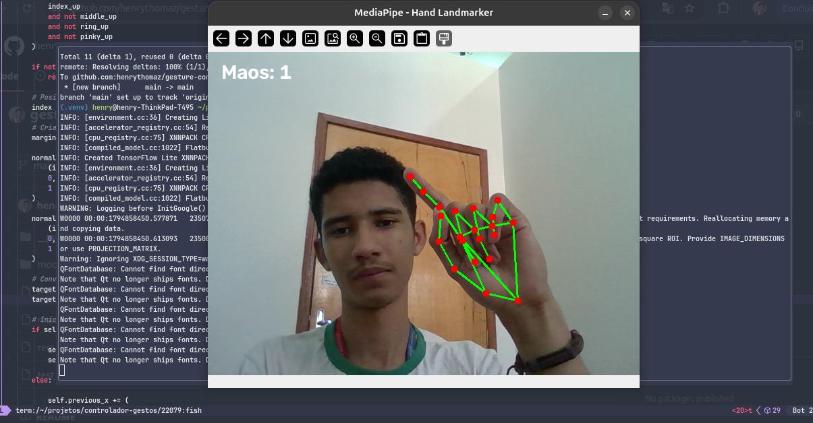
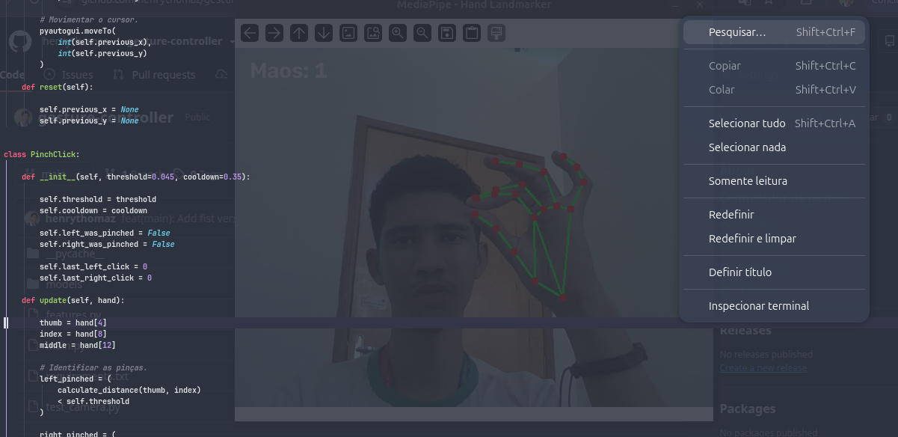
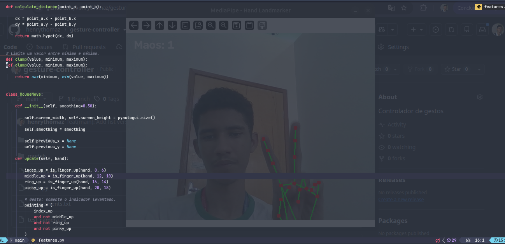

# Controlador de Gestos

Controle o computador usando movimentos das mãos capturados pela webcam.

## Como funciona

O projeto utiliza **OpenCV** para capturar os frames da câmera e **MediaPipe Hand Landmarker** para detectar a mão. O MediaPipe identifica 21 pontos (*landmarks*) em cada mão; o código analisa as posições desses pontos e transforma alguns gestos em comandos para o mouse.


*Imagem: demonstração oficial do [MediaPipe Hand Landmarker](https://developers.google.com/edge/mediapipe/solutions/vision/hand_landmarker).* 

## Ponteiro



Mantenha somente o **indicador levantado** e mova a mão para controlar a posição do cursor na tela.

## Clique



Aproxime o **polegar do indicador** para o clique esquerdo ou o **polegar do dedo médio** para o clique direito.

## Rolagem



Mantenha **indicador e dedo médio levantados**, com anelar e mindinho abaixados. Mova a mão para cima ou para baixo para rolar a página na mesma direção.

## Executar

Com o ambiente virtual ativado e as dependências instaladas, execute:

```bash
python main.py
```

Pressione **Q** na janela da câmera para encerrar.
